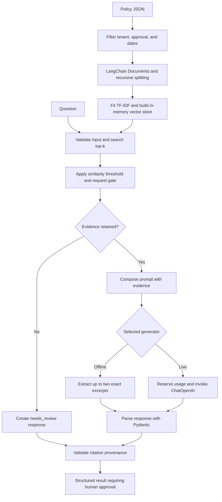

# LangChain RFP Response Assistant

An evidence retrieval and response drafting prototype for requests for proposals (RFPs) and security questionnaires, implemented as a Jupyter Notebook.

The assistant searches approved company policies, preserves source attribution, and returns structured results for human review. Its default **offline** mode extracts exact policy passages using local TF-IDF retrieval. An optional **live** mode uses `ChatOpenAI` to draft answers from the retrieved evidence.

The sample company, **Meridian Data Services**, and all policies, questions, and customer scenarios are fictional. The project also includes an evaluation of the retrieval workflow and an editable subscription business model.

**Project status:** portfolio and research prototype. The committed notebook contains a completed offline run. Live model quality, latency, provider compatibility, and invoiced cost were not validated in that run. Every response requires human approval.

## Contents

- [Capabilities and scope](#capabilities-and-scope)
- [Repository contents](#repository-contents)
- [Requirements](#requirements)
- [Installation](#installation)
- [Run the offline demonstration](#run-the-offline-demonstration)
- [Use the assistant](#use-the-assistant)
- [Enable live drafting](#enable-live-drafting)
- [Configuration](#configuration)
- [Architecture and implementation](#architecture-and-implementation)
- [Input data](#input-data)
- [Response format](#response-format)
- [Generated files](#generated-files)
- [Version control and ignored files](#version-control-and-ignored-files)
- [Evaluation and validation](#evaluation-and-validation)
- [Cost accounting and business model](#cost-accounting-and-business-model)
- [Customize the project](#customize-the-project)
- [Troubleshooting](#troubleshooting)
- [Security, privacy, and operational limits](#security-privacy-and-operational-limits)
- [Development and contributions](#development-and-contributions)
- [Research and technical references](#research-and-technical-references)
- [Author and license](#author-and-license)

## Capabilities and scope

The notebook demonstrates:

- Policy eligibility filtering by tenant, approval, effective date, and expiration date before indexing.
- LangChain document ingestion, recursive text splitting, and inspectable chunk identifiers.
- Local TF-IDF word and bigram retrieval through `InMemoryVectorStore`.
- LangChain Expression Language (LCEL) orchestration, prompt construction, branching, and batch execution.
- Pydantic response parsing and validation of citation source IDs and exact quotations.
- Explicit review routing for restricted requests, missing evidence, and invalid citations.
- Optional live drafting with request reservations, usage accounting, and bounded output.
- Retrieval evaluation on 20 labeled synthetic questions and eight built-in checks.
- Financial scenarios, customer capacity estimates, and support workload sensitivity.

The two modes share retrieval, response parsing, and citation validation:

| Behavior | Offline, the default | Live, optional |
| --- | --- | --- |
| Retrieval | Local TF-IDF and cosine similarity | The same local retrieval |
| Answer preparation | Up to two verbatim excerpts; no generated answer | Model drafts from up to three retained chunks |
| Normal response status | `evidence_only` | `draft` or `needs_review` |
| API key | Not required | `OPENAI_API_KEY` required for provider calls |
| Model or embedding download | None | Remote model inference; embeddings remain local |
| Provider charges | No model or embedding API charges | Possible model charges |
| Human approval | Required | Required |

This repository provides a notebook workflow. It does not include a web application, REST service, command-line application, PDF/DOCX ingestion pipeline, persistent vector database, or customer-facing approval system. The companion reports explain the project; the notebook does not ingest them as evidence.

## Repository contents

```text
langchain-rfp-response-assistant/
├── .gitignore
├── README.md
├── LangChain_RFP_Assistant.ipynb
├── LangChain_RFP_Report_Todd_DeLozier.docx
└── LangChain_RFP_Report_Todd_DeLozier.pdf
```

| File | Purpose |
| --- | --- |
| [.gitignore](.gitignore) | Keeps local environments, credentials, generated data and outputs, caches, and filesystem metadata out of Git. |
| [LangChain_RFP_Assistant.ipynb](LangChain_RFP_Assistant.ipynb) | Executable implementation, synthetic seed data, saved results, charts, and financial model. |
| [LangChain_RFP_Report_Todd_DeLozier.pdf](LangChain_RFP_Report_Todd_DeLozier.pdf) | Narrative report covering the design, findings, limitations, and business case. |
| [LangChain_RFP_Report_Todd_DeLozier.docx](LangChain_RFP_Report_Todd_DeLozier.docx) | Editable Word version of the report. |

The notebook creates `data/` and `outputs/` when run. These directories, a `requirements.txt`, and a dependency lock file are not included in the repository snapshot. References in the notebook and report to a requirements file or a larger packaged distribution do not describe the files currently checked in; use the installation instructions below.

Files beginning with `._`, if present on macOS or an external volume, are filesystem metadata and are ignored by Git. Generated `data/` and `outputs/` directories are also ignored; the synthetic baseline remains embedded in the notebook.

## Requirements

- **Python 3.12.** The saved execution records Python **3.12.14**. Other Python versions are not established by the saved run.
- A terminal and a browser for JupyterLab, or another Jupyter-compatible notebook editor.
- Internet access to install dependencies. Once installed, the default workflow requires no API key, remote inference, or model download.
- For live mode only: an OpenAI API key, provider access to the configured model, and network connectivity.

The notebook uses these third-party packages:

| Package | Role |
| --- | --- |
| `langchain-core` | Documents, embeddings interface, in-memory vector store, prompts, runnables, and output parser. |
| `langchain-text-splitters` | Recursive character splitting. |
| `langchain-openai` | Optional live model integration. Also required offline because setup reads its installed version. |
| `scikit-learn` | TF-IDF vectorization. |
| `pydantic` 2.x | Typed response and citation schemas. |
| `numpy` | Numerical operations and zero-vector detection. |
| `pandas` | Evaluation tables and CSV exports. |
| `matplotlib` | Evaluation and sensitivity charts. |
| `ipython` | Notebook display utilities; installed through `ipykernel` below. |
| `jupyterlab`, `ipykernel`, `nbconvert` | Notebook UI, Python kernel, and optional execution from a terminal. |

The saved setup output records `langchain-core==1.8.1` and `langchain-openai==1.8.0`. The installation command pins those two versions. Remaining dependencies are resolved at installation time, so this is not a complete reconstruction of the original environment.

## Installation

Clone or download the repository. The commands below assume your terminal starts in the directory containing the checkout.

### macOS or Linux

```bash
cd langchain-rfp-response-assistant
python3.12 -m venv .venv
source .venv/bin/activate
python -m pip install --upgrade pip
```

### Windows PowerShell

```powershell
cd langchain-rfp-response-assistant
py -3.12 -m venv .venv
.\.venv\Scripts\Activate.ps1
python -m pip install --upgrade pip
```

If local PowerShell policy prevents activation, invoke `.\.venv\Scripts\python.exe` directly in place of `python`; environment activation is optional.

### Install dependencies and register the kernel

Run the following inside the activated environment. The dependency command is one line and works in either shell:

```bash
python -m pip install "langchain-core==1.8.1" "langchain-openai==1.8.0" langchain-text-splitters "pydantic>=2,<3" numpy pandas matplotlib scikit-learn jupyterlab ipykernel nbconvert
python -m pip check
python -m ipykernel install --user --name rfp-response-assistant --display-name "RFP Assistant (Python 3.12)"
```

Keep `langchain-openai` installed even if you only use offline mode: the setup cell calls `version("langchain-openai")` before any live branch runs.

To capture an environment after a successful run, save a local dependency snapshot:

```bash
python -m pip freeze > requirements-local.txt
```

That file describes your environment and is ignored by Git; it is not an existing project requirements file.

## Run the offline demonstration

From the repository root with the environment activated:

```bash
python -m jupyter lab
```

1. Open `LangChain_RFP_Assistant.ipynb`.
2. Select the **RFP Assistant (Python 3.12)** kernel.
3. Confirm the setup cell contains `MODE = "offline"`.
4. Choose **Restart Kernel and Run All Cells**.

The notebook uses `Path.cwd()` as its root. Start Jupyter from the project directory so that generated files appear in this checkout. The run creates synthetic input files if missing, filters the policies, builds the index, processes five demonstration questions, evaluates all 20 questions offline, executes the boundary checks, and exports the financial scenarios and charts.

With the unmodified seed data and configuration, ingestion should report:

```python
{"input_documents": 15, "eligible_documents": 12, "chunks": 12}
```

The default offline path uses real LangChain processing, prompt composition, parsing, and validation. It returns evidence packets rather than generated prose answers.

### Execute from a terminal

For an offline run without opening the JupyterLab interface, confirm `MODE = "offline"` in the notebook and run:

```bash
python -m jupyter nbconvert --to notebook --execute LangChain_RFP_Assistant.ipynb --output LangChain_RFP_Assistant.executed.ipynb --output-dir outputs --ExecutePreprocessor.kernel_name=rfp-response-assistant --ExecutePreprocessor.timeout=300
```

This writes an executed copy under `outputs/` and produces the notebook's normal data and output files. It leaves the original notebook file untouched. Execution follows the saved configuration; this command does not override `MODE`.

## Use the assistant

Run the notebook's definitions first. Add interactive examples in a new cell after the setup, ingestion, retrieval, and chain construction cells have completed.

### Ask one question

```python
result = offline_chain.invoke("Have you completed a SOC 2 Type II audit?")
display(result)
```

The sample policy explicitly states that Meridian has not completed that audit. Offline mode returns that policy as evidence and leaves interpretation to the reviewer. A negative factual answer can be supported even when a requested certification is absent.

### Ask several questions

```python
results = offline_chain.batch(
    [
        "Which encryption protects stored customer data?",
        "What are the disaster recovery RTO and RPO targets?",
        "What is your cyber insurance coverage limit?",
    ],
    config={"max_concurrency": 2},
)
display(pd.DataFrame(results)[["question", "status", "answer"]])
```

The insurance question has no supporting policy and is routed to review with the seed data. Calling a chain interactively returns results in memory; it does not automatically append them to the demonstration response files. The export statements in the notebook write those files explicitly.

### Inspect retrieval

```python
for document, score in ranked_search("What is the disaster recovery target?"):
    print(document.metadata["source_id"], round(float(score), 3))
    print(document.page_content)

display(prepare("What is the disaster recovery target?"))
```

`ranked_search()` exposes raw top-k candidates before thresholding and request gating. `prepare()` shows the evidence retained for the response chain. Similarity measures lexical relevance; it is not a confidence score for answer correctness.

## Enable live drafting

The optional live branch is implemented, but the committed execution did not make paid model calls.

1. Set `OPENAI_API_KEY` in the environment used to launch Jupyter. For example, replace the placeholder locally:

   ```bash
   export OPENAI_API_KEY="your-api-key"
   python -m jupyter lab
   ```

   In Windows PowerShell:

   ```powershell
   $env:OPENAI_API_KEY = "your-api-key"
   python -m jupyter lab
   ```

   Use your normal secret management method for real credentials. Do not put a key in a notebook cell, committed file, screenshot, or saved output. The notebook does not load a `.env` file automatically.

2. Change the setup cell to:

   ```python
   MODE = "live"
   MODEL = "gpt-6-luna"
   ```

3. Check that the account can use the configured model. Review `INPUT_PER_M` and `OUTPUT_PER_M` against the provider's pricing before making calls, especially if changing the model. The README describes the notebook's configured assumptions; it does not establish current provider prices or model access.
4. Restart the kernel and run all cells. The five demonstration questions use the live branch sequentially. The 20-question research evaluation and boundary checks continue to use `offline_chain`.
5. Inspect `outputs/live_responses.json` and `outputs/live_usage.json`, then review every draft against its cited evidence.

After definitions have run, you can also call:

```python
result = live_chain.invoke("Have you completed a SOC 2 Type II audit?")
display(result)
```

Calling `live_chain` explicitly can contact the provider regardless of `MODE`; `MODE` selects `active_chain` for the built-in demonstration. The live usage ledger is written by the call itself, while response exports require the notebook's export statements or your own save operation.

Live requests send the question and selected evidence to the provider, along with the system prompt and output schema. Retrieval remains local. The default API configuration uses the Responses API, `reasoning_effort="none"`, a 60-second timeout, and no automatic retries.

Requests without retained evidence bypass generation. In the five-question live demonstration, request and parsing exceptions become `needs_review` records with the exception class in `reason`. Direct `live_chain.invoke()` calls raise those exceptions to the caller.

To return to the default workflow, set `MODE = "offline"`, restart the kernel, and rerun the notebook.

## Configuration

Configuration is defined in notebook cells, rather than a separate settings file or command-line flags.

| Setting | Default | Meaning |
| --- | --- | --- |
| `MODE` | `"offline"` | Selects the demonstration chain; allowed values are `offline` and `live`. |
| `MODEL` | `"gpt-6-luna"` | Model identifier supplied to `ChatOpenAI`; also recorded in the financial model. |
| `AS_OF` | `date(2026, 11, 17)` | Fixed policy eligibility date. It does not advance with the system date. |
| `TENANT` | `"meridian"` | Tenant selected before indexing. |
| `K` | `3` | Maximum retrieved candidates. The evaluation column is named `hit_at_3` and assumes this default. |
| `MIN_SIMILARITY` | `0.18` | Minimum cosine similarity retained as evidence. |
| `ROOT` | `Path.cwd()` | Working directory for generated files. |
| `DATA`, `OUT` | `ROOT / "data"`, `ROOT / "outputs"` | Local input and output directories. |
| Splitter arguments | `chunk_size=450`, `chunk_overlap=60` | Character-based chunk sizing; edit the splitter construction. |
| `INPUT_PER_M` | `0.10` | Assumed USD per million input tokens for cost calculations. |
| `OUTPUT_PER_M` | `0.50` | Assumed USD per million output tokens for cost calculations. |
| `MAX_OUTPUT_TOKENS` | `2048` | Maximum requested live output tokens and reservation allowance. |
| `MAX_REQUESTS` | `20` | Maximum entries in the in-memory live ledger. |
| `SESSION_BUDGET_USD` | `0.25` | Maximum cumulative reserved live spend in the current ledger. |

Additional limits are literal values in functions: questions must be nonempty strings of at most **2,000 characters**, and live requests must fit an input allowance of **12,000**, calculated as prompt UTF-8 bytes plus 512. The allowance is a guard, not a measured token count.

The setup cell sets both `LANGSMITH_TRACING` and `LANGCHAIN_TRACING_V2` to `"false"`. An `OPENAI_API_KEY` is only read when a live provider call is attempted.

Changing settings does not rebuild existing Python objects automatically. Restart and rerun after changing the mode, tenant, date, source data, retrieval configuration, or prices. Cost helper defaults capture the rates when the function is defined, so rerunning only a price assignment can leave old rates in use.

## Architecture and implementation



### Ingestion and retrieval

`eligible(record)` admits a policy only when:

```python
record["tenant"] == TENANT
record["approved"] is True
date.fromisoformat(record["effective"]) <= AS_OF < date.fromisoformat(record["expires"])
```

The effective date is inclusive; the expiration date is exclusive. Only eligible records become LangChain `Document` objects. All fields except `text` are copied into metadata.

`RecursiveCharacterTextSplitter` adds a starting character index to each chunk. A chunk ID combines the source ID, start offset, and the first 12 hexadecimal characters of a SHA-256 content hash:

```text
source_id:start_index:content_hash
```

`TfidfEmbeddings` implements the LangChain `Embeddings` interface with scikit-learn's `TfidfVectorizer(ngram_range=(1, 2), stop_words="english")`. It fits on eligible policy chunks only. Questions and evaluation labels do not train the vectorizer.

TF-IDF vectors are converted to dense lists for the in-memory vector store. They are lexical vectors, not learned semantic embeddings. `ranked_search()` uses cosine similarity and returns no candidates when a query has no vocabulary overlap, avoiding a zero-vector cosine search.

`prepare()` validates input, retrieves candidates, applies the similarity threshold, and clears evidence for requests matching `ignore.*instructions|password|api.?key`, case-insensitively. Its `gate_reason` is `evidence_found`, `low_retrieval_score`, or `restricted_request`.

### Chain composition

The shared chain is:

```python
RunnableLambda(prepare) | RunnablePassthrough.assign(response=route) | RunnableLambda(validate_result)
```

`RunnableBranch` supplies the route. With no retained evidence, it returns a typed review response. With evidence, it invokes a generator constructed from a JSON payload function, `ChatPromptTemplate`, the selected extraction/model function, and `PydanticOutputParser`.

The offline function reads the composed prompt and emits exact excerpts. The live function requests a concise draft with exact supporting quotations and instructs the model to route unsupported or conflicting claims to review.

`validate_result()` checks that each citation names a retained source and contains a nonempty exact substring of that source's retained text. A `draft` or `evidence_only` result without citations is withheld as `needs_review`. Valid quotations establish provenance; the validator does not determine whether every answer claim is supported by those quotations.

## Input data

The notebook seeds two JSON files only if they do not already exist. Existing files are loaded as-is; editing the seed variables does not overwrite an existing dataset.

### Policies: `data/policies.json`

The file is a JSON array of policy records:

```json
[
  {
    "source_id": "SEC01",
    "title": "Encryption",
    "text": "Customer data is encrypted at rest using AES-256. Network connections use TLS 1.2 or later. Encryption keys are rotated annually and managed through the cloud key management service.",
    "tenant": "meridian",
    "approved": true,
    "version": "1.0",
    "effective": "2026-01-01",
    "expires": "2027-01-01"
  }
]
```

| Field | Expected type | Purpose |
| --- | --- | --- |
| `source_id` | String | Policy identifier used by citations and evaluation labels. |
| `title` | String | Human-readable policy title. |
| `text` | String | Evidence to split and index. |
| `tenant` | String | Eligibility boundary for the selected tenant. |
| `approved` | JSON boolean | Only literal `true` is eligible; the string `"true"` is not equivalent. |
| `version` | String | Policy version retained in evidence metadata. |
| `effective` | ISO date string, `YYYY-MM-DD` | First eligible date. |
| `expires` | ISO date string, `YYYY-MM-DD` | First ineligible date. |

The seed corpus has 12 eligible policies covering encryption, identity and access, incident management, disaster recovery, retention and deletion, residency, assurance status, delivery, integrations, availability, project governance, and commercial terms.

Three additional records exercise exclusion: `SEC01_OLD` is expired, `OTHER01` belongs to another tenant, and `DRAFT01` is unapproved. `OTHER01` contains a synthetic secret marker; it is deliberately not indexed for Meridian.

The input JSON is not validated by the Pydantic response schemas. Missing fields, invalid dates, incompatible types, or an empty eligible corpus can stop execution. Maintain one active version per source ID: the prototype does not resolve overlapping active versions or conflicting policies.

### Questions: `data/questions.json`

```json
[
  {
    "question_id": "Q01",
    "question": "Which encryption protects stored customer data?",
    "expected_sources": ["SEC01"],
    "answerable": true
  }
]
```

| Field | Expected type | Purpose |
| --- | --- | --- |
| `question_id` | String | Stable evaluation identifier. |
| `question` | String | Input passed to retrieval and the response chain. |
| `expected_sources` | Array of strings | Relevant source IDs for retrieval diagnostics; use `[]` where none exists. |
| `answerable` | JSON boolean | Human-authored label for whether the requested claim is supported. |

A relevant source can exist even when the requested claim is unsupported. For example, a 30-day deletion policy is relevant to a question requesting a 24-hour guarantee, but it does not support that guarantee. Consequently, some `answerable: false` questions still have expected sources.

The default set contains 20 questions, including six negative cases. The demonstration processes the first five entries. Evaluation uses the complete list.

## Response format

The parsed `Response` schema requires `status`, `answer`, `citations`, and `reason`. Both `Response` and `Citation` forbid extra fields. Final validation adds the original question, retained source IDs, and the human approval marker.

| Field | Type | Meaning |
| --- | --- | --- |
| `question` | String | Original input question. |
| `status` | `evidence_only`, `draft`, or `needs_review` | Evidence packet, proposed live answer, or withheld/review result. |
| `answer` | String | Answer text or explanation that no draft was produced. |
| `citations` | Array of `{source_id, quote}` objects | Source identifiers and exact supporting text. |
| `reason` | String | Explanation for extraction, drafting, review routing, or validation failure. |
| `human_approval_required` | Boolean | Always `true` in the application result. |
| `retrieved_sources` | Array of strings | Sources retained after thresholding and gating; may exceed the cited subset. |

Example from the saved offline SOC 2 question:

```json
{
  "question": "Have you completed a SOC 2 Type II audit?",
  "status": "evidence_only",
  "answer": "Retrieved excerpts for human review; no generated answer.",
  "citations": [
    {
      "source_id": "COMP01",
      "quote": "Meridian has not completed a SOC 2 Type II audit and does not hold ISO 27001 certification. A SOC 2 readiness assessment is underway. Readiness work must not be represented as an attestation or certification."
    }
  ],
  "reason": "Local extractive baseline; answerability has not been inferred.",
  "human_approval_required": true,
  "retrieved_sources": ["COMP01"]
}
```

`evidence_only` does not establish answerability. `draft` does not record approval. `needs_review` may indicate missing evidence, a restricted request, citation failure, model uncertainty, or a failed live request. The live demonstration's exception records omit `retrieved_sources`; downstream consumers should account for that fallback shape.

## Generated files

All paths are relative to the notebook kernel's working directory. The root `data/` and `outputs/` directories are ignored by Git, so running the demonstration does not add these artifacts to version control.

| File | Written when | Contents |
| --- | --- | --- |
| `data/policies.json` | Missing at initialization | Synthetic policy corpus. |
| `data/questions.json` | Missing at initialization | Synthetic questions and evaluation labels. |
| `outputs/offline_responses.json` | Offline demonstration | Structured results for the first five questions. |
| `outputs/offline_responses.csv` | Offline demonstration | Tabular version of those results. |
| `outputs/live_responses.json` | Live demonstration | Live results or review records for failed attempts. |
| `outputs/live_responses.csv` | Live demonstration | Tabular version of live results. |
| `outputs/live_usage.json` | Live provider attempts | Current ledger of reservations, request status, and available provider usage. |
| `outputs/evaluation.csv` | Evaluation | Question labels, rankings, hit metrics, routing status, similarity, and local latency. |
| `outputs/metrics.json` | Evaluation | Aggregate metrics. |
| `outputs/evaluation.png` | Evaluation | Retrieval and review-routing chart. |
| `outputs/checks.csv` | Built-in checks | Eight successful check records if all assertions pass. |
| `outputs/financial_scenarios.csv` | Economics calculation | Scenarios for 1, 3, 10, and 25 customers. |
| `outputs/financial_model.json` | Economics calculation | Assumptions, configured model and rates, base scenario, and customer value calculations. |
| `outputs/support_sensitivity.csv` | Sensitivity calculation | Ten-customer results for 2–12 support hours per customer. |
| `outputs/customer_sensitivity.csv` | Sensitivity calculation | Capacity and net value across assisted-question shares. |
| `outputs/support_sensitivity.png` | Sensitivity calculation | Support workload versus operating surplus. |

Use JSON exports when consuming nested citations; CSV exports serialize lists and objects into cells rather than a normalized relational schema.

Rerunning cells overwrites their corresponding outputs. Existing data files are preserved, and outputs from an earlier mode can remain beside newer files. `evaluation.*`, `metrics.json`, and financial outputs are shared filenames, not separate offline/live histories. Archive results separately when comparing runs. The notebook does not automatically regenerate either companion report.

## Version control and ignored files

The repository's [.gitignore](.gitignore) keeps machine-specific and generated files local:

| Category | Examples ignored |
| --- | --- |
| Virtual environments | `.venv/`, `venv/`, `env/`, `ENV/` |
| Local credentials and settings | `.env`, `.env.*`; a future sanitized `.env.example` template is explicitly allowed. |
| Generated inputs | Root `data/`, including seeded policies/questions and any local replacements. |
| Generated results | Root `outputs/`, including response exports, usage records, metrics, and charts. |
| Notebook working files | `.ipynb_checkpoints/` and `*.executed.ipynb` copies. |
| Python artifacts | Bytecode, tool caches, coverage reports, and build directories. |
| Local dependency snapshots and logs | Root `requirements-local.txt` and `*.log`. |
| Editor working files | `.vscode/`, `.idea/`, swap files, and backup files ending in `~`. |
| Operating system metadata | `.DS_Store`, AppleDouble `._*` files, and Windows thumbnail metadata. |

The original notebook, README, `.gitignore`, and companion PDF/DOCX reports remain eligible for version control. A clone can recreate the synthetic input files from the notebook without committing generated directories. Back up custom policies and questions separately, since Git will not track changes inside the ignored `data/` directory by default. If reviewed synthetic fixtures need to be versioned later, narrow the corresponding ignore rules deliberately.

Inspect the working tree and identify which rule ignores a path with:

```bash
git status --short
git check-ignore -v data/policies.json outputs/metrics.json .env .venv/pyvenv.cfg
```

Ignore rules apply to untracked files. They do not delete local files, remove files already tracked by Git, or filter sensitive material from the saved contents of a tracked notebook. Review notebook outputs and staged changes before sharing.

## Evaluation and validation

### Saved offline baseline

These figures come from the committed notebook's saved run using the original synthetic data and defaults:

| Measure | Saved result |
| --- | --- |
| Input policies / eligible policies / chunks | 15 / 12 / 12 |
| Questions | 20 |
| Questions with nonempty source labels | 17 |
| Retrieval Hit@1 | 12/17, **70.6%** |
| Retrieval Hit@3 | 15/17, **88.2%** |
| Expected source retained after threshold and gate | 12/17, **70.6%** |
| Negative cases routed to `needs_review` | 5/6, **83.3%** |
| Median local evaluation-loop latency | Approximately **3.37 ms** |
| Built-in checks passed | **8** |
| Paid API calls | **0** |

Hit@k means that at least one labeled relevant source appeared among the top k raw retrieval results. Questions with no expected sources are excluded from its denominator. `retained_hit` checks whether a labeled source survived the threshold and request gate. These metrics measure source retrieval, not answer accuracy or completeness.

`negative_review_rate` counts only `needs_review` on questions labeled unanswerable. An `evidence_only` result still needs human review, but does not count as successful automated abstention.

Latency covers each evaluation-loop iteration, including a separate ranking call and an offline chain call. It excludes installation, index construction, human review, and network inference. It is specific to the small corpus and execution environment.

### Failures to inspect

- **Q08, implementation duration:** the expected policy appears in the top three, but its similarity is below the retention threshold, so the response needs review.
- **Q13, paraphrased recovery question:** indirect wording fails to retrieve the disaster recovery policy in the top three.
- **Q20, deletion within 24 hours:** lexical overlap retains incident-response evidence and produces `evidence_only` instead of `needs_review`. No generated guarantee is issued, but automated negative-case routing fails.

These examples show why retrieval relevance and exact quotations alone cannot establish that a requested claim is supported. The questions were authored for the project, and no held-out customer benchmark or live generation quality evaluation is included.

### Built-in checks

The notebook's failure-handling section asserts:

1. Only the expected approved tenant sources are indexed; the three exclusion examples are absent.
2. Empty, oversized, and non-string questions are rejected.
3. Invalid source IDs or quotations are withheld.
4. Uncited drafts are withheld.
5. Unknown-vocabulary queries route to review.
6. Restricted requests route to review.
7. Every demonstration result requires human approval.
8. Token-cost arithmetic matches the configured rates.

Run all cells to reproduce these checks. There is no separate test suite or CI configuration in this snapshot. The report describes the original validation as sequential execution of all ten code cells through IPython; it does not claim a separate JupyterLab interface test or paid inference validation.

Changing `K` also requires updating evaluation column names and chart labels that currently say Hit@3. Raw search uses the configurable `K`, while those labels are fixed strings.

## Cost accounting and business model

### Live request accounting

The live function reserves estimated spend **before** each call:

```text
input_allowance = UTF-8 byte length of prompt text + 512
reservation_usd = (input_allowance × input_rate + 2048 × output_rate) / 1,000,000
```

It rejects requests above the input allowance, beyond 20 ledger entries, or above $0.25 in cumulative reservations. Failed requests retain their reservation and receive `failed_or_unknown` status. Successful requests record latency, model metadata, input/output tokens when supplied, and a token-based cost estimate. Missing token metadata produces a null estimate.

Reservations and provider-reported usage are different measures. Usage estimates price all input as uncached; they can overestimate charges when cache discounts apply. Neither calculation replaces the provider invoice or an account-level spending limit.

The ledger is in memory and is rewritten to `live_usage.json`. Restarting the kernel **or rerunning the ledger initialization cell** resets it; the function does not reload previous reservations from disk. Sequential calls protect the demonstration's accounting order. Do not use concurrent live batch calls with this in-memory check; persistent, atomic accounting would be needed for a shared service.

The research evaluation remains offline in either mode. In a live run, the `paid_api_calls_in_saved_offline_run` metric contains the current ledger length, including failed attempts; it is not a measured count of successfully invoiced calls.

### Editable assumptions

The notebook's economics section defines `ASSUMPTIONS`:

| Assumption | Default |
| --- | --- |
| Monthly subscription / questions per customer | $750 / 500 |
| Input / total billable output tokens per attempted question | 3,000 / 800 |
| Additional-attempt allowance | 10% |
| Support per customer | 2 hours/month at $60/hour |
| Hosting allocation per customer | $30/month |
| Payment processing | 3% |
| Shared monthly costs | $1,200 |
| Initial build | 120 hours at $100/hour |
| Customer acquisition | $1,000/customer |
| Setup fee | $1,500/customer |
| Onboarding | 10 hours at $75/hour |
| Manual completion / assisted review time | 6 / 2 minutes per question |
| Share of questions assisted | 70% |
| Customer labor capacity value | $75/hour |

At the notebook's assumed rates of $0.10 per million input tokens and $0.50 per million output tokens:

```text
cost_per_attempt = (3000 × 0.10 + 800 × 0.50) / 1,000,000 = $0.0007
monthly_api_per_customer = 500 × 1.10 × $0.0007 = $0.385
monthly_direct_cost_per_customer = $0.385 + $120 + $30 + $22.50 = $172.885
monthly_operating_surplus = customers × ($750 - $172.885) - $1,200
```

The 10% additional-attempt allowance is a forecast assumption. It does not enable retries in the live function.

### Baseline scenario outputs

| Result | Modeled value |
| --- | --- |
| Supplier operating break-even | 3 active customers |
| Revenue at 10 customers | $7,500/month |
| Operating surplus at 10 customers | $4,571.15/month |
| Contribution margin before shared monthly costs | Approximately 76.95% |
| Net initial outlay at 10 customers | $14,950 |
| Steady-state payback at 10 customers | Approximately 3.27 months |
| Customer capacity released at 500 questions | Approximately 23.33 hours/month |
| Customer capacity value | $1,750/month |
| Customer recurring net value after subscription | $1,000/month |
| Customer return on recurring subscription | Approximately 133.3% |
| Monthly questions to cover subscription at assumed savings | Approximately 215 |

These are planning scenarios, not observed revenue, market-validated pricing, measured productivity, or accounting net profit. Capacity value becomes cash savings only when it avoids paid effort or another expense. Customer recurring value calculations exclude the initial setup fee.

Payback assumes customers are acquired together and remain active. The model excludes taxes, financing, refunds, churn, and working capital, and its linear scaling may understate staffing and infrastructure needs. The support and customer sensitivity sections expose how results change when support work rises or fewer questions benefit from assistance.

## Customize the project

### Replace or extend the policies

1. Run initialization once to create `data/policies.json`, or create a JSON array using the documented schema.
2. Edit the file with authorized evidence, appropriate tenant IDs, approval flags, versions, and validity dates.
3. Keep one active version per source and check that `AS_OF` is within the intended date range.
4. Restart and run all cells to reload records, split text, refit TF-IDF, and rebuild the index.
5. Inspect retrieved passages and update question labels to match the revised corpus.

A running index does not watch files for changes. Direct use of PDF, Word, CSV, or a document repository would require a new loader that produces the same policy records or LangChain documents.

### Change questions or add a benchmark

Edit `data/questions.json`, preserve stable IDs, and label supporting sources independently of the retrieval results. Include supported questions, paraphrases, missing facts, conflicting commitments, and restricted requests. Keep a set of labels reserved for evaluation if tuning retrieval parameters on other examples.

Restart and rerun after edits. The first five questions feed the demonstration; all entries feed the offline evaluation. For meaningful aggregate metrics, retain both source-labeled questions and negative cases.

### Tune retrieval or change the model

Adjust `K`, `MIN_SIMILARITY`, or the splitter arguments, rebuild the index, and compare retained evidence and negative-case routing. Larger context and lower thresholds can admit more irrelevant passages; select settings using labeled results and reviewer assessment.

To try semantic or hybrid retrieval, replace or extend the `TfidfEmbeddings`/vector-store stage and benchmark against the same labels. Learned dense retrieval is a proposed extension, not part of the current implementation.

For another live model, update `MODEL`, both token price constants, and any model-specific `ChatOpenAI` arguments. Recheck output parsing, exact quotations, unsupported claims, and usage metadata. A model change alone does not update the notebook's fixed `pricing_checked` label; update that label when reviewing rates.

### Change the financial scenarios

Edit `ASSUMPTIONS` and rerun economics and sensitivity calculations. The customer sensitivity table currently hard-codes `500`, `6`, `2`, `75`, and `750` in its formulas; update those literals too when changing the corresponding workload, time, labor value, or subscription assumptions. Restarting and rerunning ensures token-cost defaults reflect any rate changes.

### Restore the synthetic baseline

Back up any custom input files, then move or remove only `data/policies.json` and `data/questions.json` and rerun initialization. The notebook recreates missing files from its seed variables. Removing outputs alone does not restore input data.

## Troubleshooting

| Symptom | Cause and action |
| --- | --- |
| `requirements.txt` cannot be found | It is not included. Use the explicit dependency installation command in this README. |
| `python3.12` or `py -3.12` is unavailable | Install Python 3.12 or select an existing 3.12 interpreter before creating the environment. |
| `ModuleNotFoundError` or package metadata errors | Install dependencies in the same environment as the selected kernel. `langchain-openai` is required for the setup version check even offline. |
| Packages are installed but imports still fail | Check `import sys; print(sys.executable)` in the notebook and select the registered project kernel. |
| `NameError` for a chain or helper | Cells were run out of order. Restart and run all cells. |
| No eligible policies, or TF-IDF reports an empty vocabulary | Check tenant, literal boolean approval, dates, and policy text. The notebook does not handle an empty index as a normal state. |
| Changing seed data has no effect | Existing JSON files take precedence. Edit those files or back them up and regenerate them. |
| Editing JSON does not change retrieval | Reload records and rebuild the index by restarting and rerunning. |
| Relevant-looking question returns `needs_review` | The gate may have matched, vocabulary may be absent, similarity may be below `0.18`, or validation may have failed. Inspect `prepare()` and raw rankings. |
| Expected source appears in raw results but not citations | The source may fail the similarity threshold; offline extraction cites only the first two retained chunks. |
| Empty, non-string, or overlong input raises `ValueError` | Supply a nonempty string of at most 2,000 characters. Input validation failures are not converted into normal offline results. |
| API key missing after setting it in a terminal | Launch Jupyter from that environment. A running server does not inherit later changes to a different shell. `.env` files are not loaded automatically. |
| Live output says `Request failed.` | Inspect `reason` and the usage ledger. Check authentication, model access, provider compatibility, network, input allowance, and reservation limits. Direct calls surface the exception. |
| Live JSON parsing or citation validation fails | Treat the result as requiring review. The demonstration catches parsing exceptions, and invalid citation provenance causes withholding; there is no automatic repair loop. |
| Reservation limit is reached | Review the ledger and failed attempts before adjusting limits. Resetting the kernel or initialization cell clears only local accounting and does not cancel provider charges. |
| Live latency or quality seems absent from metrics | Evaluation deliberately runs offline. Separate live evaluation is not implemented. |
| Files appear in an unexpected directory | Inspect `Path.cwd()` and start the kernel from the repository root, or set an explicit `ROOT`. |
| Chart font differs | Matplotlib falls back from Times New Roman to DejaVu Serif when needed. |
| Old live files remain after an offline run | Mode-specific response files are not automatically deleted. Compare files from the intended run. |
| Generated files do not appear in `git status` | Root `data/` and `outputs/` are ignored intentionally. Use `git check-ignore -v path/to/file` to inspect the matching rule. |

## Security, privacy, and operational limits

The prototype provides an inspectable evidence boundary, not a complete security or approval system:

- Tenant selection is an editable constant, not authenticated authorization. Production must derive identity from authentication and enforce access in storage and retrieval.
- Source filtering excludes the supplied expired, cross-tenant, and unapproved examples. It does not resolve conflicting active versions or establish that an approved statement is factually correct.
- The keyword gate is narrow and can miss adversarial phrasing or reject benign questions. Prompt instructions and exact-quote checks do not prove general prompt-injection resistance.
- Citation validation verifies provenance, not that every claim follows from the evidence. It does not detect all omissions, unsupported inferences, or commercial overcommitments.
- `human_approval_required` is a marker. No approval event, reviewer identity, immutable audit log, or approval-controlled export is implemented. The notebook has no buyer-sending capability.
- TF-IDF and the index are local and in memory. Sources, responses, questions, charts, and usage records are written to local files without a persistence or encryption layer supplied by the project.
- Tracing is disabled in setup. Live mode still sends the selected question and evidence to the provider. Assess the applicable data handling arrangements before substituting real company material.
- Request reservations are session-local safeguards. Shared or deployed use requires persistent accounting, concurrency controls, and independently configured provider limits.

Before an external deployment, implement authenticated tenancy, durable policy versions, duplicate/version checks, storage authorization, persistent indexes and billing records, and a review interface with an audit trail. Evaluate live drafts with domain reviewers for factual support, qualifications, omissions, and editing time. The report proposes pilot targets; those targets are future acceptance criteria rather than achieved results.

## Development and contributions

The implementation resides in ten code cells interleaved with explanatory Markdown. There is no packaged Python module, application server, deployment configuration, or automated release workflow.

For a change:

1. Use an isolated environment and keep credentials outside project files.
2. Update the relevant notebook cells and this README when behavior or setup changes.
3. Run the complete offline workflow with the intended input data and inspect the boundary checks, metrics, and citations.
4. Compare retrieval failures and financial outputs with the saved baseline; explain intentional changes.
5. Review notebook diffs, saved outputs, and staged changes for credentials, private policies, or customer questions before sharing. Follow the [version control guidance](#version-control-and-ignored-files); `.gitignore` excludes local artifacts but does not inspect the contents of the tracked notebook.

Live tests are separate, optional, potentially paid checks. Report their model, corpus, settings, usage, and review method when making claims about generation quality. The reports are static artifacts and must be updated separately if their claims change.

## Research and technical references

The notebook and report cite the following research as design context. The project applies general RAG concepts; it does not reproduce a jointly trained RAG model, implement DPR or Self-RAG training, or run the RAGAS package.

| Publication | Connection to the project |
| --- | --- |
| Lewis et al. (2020), [Retrieval-Augmented Generation for Knowledge-Intensive NLP Tasks](https://proceedings.neurips.cc/paper_files/paper/2020/file/6b493230205f780e1bc26945df7481e5-Paper.pdf) | Retrieve external evidence before drafting. |
| Karpukhin et al. (2020), [Dense Passage Retrieval for Open-Domain Question Answering](https://doi.org/10.18653/v1/2020.emnlp-main.550) | Motivation for comparing the lexical baseline with learned retrieval. |
| Liu et al. (2024), [Lost in the Middle: How Language Models Use Long Contexts](https://doi.org/10.1162/tacl_a_00638) | Keep selected context limited and clearly attributed. |
| Es et al. (2024), [RAGAs: Automated Evaluation of Retrieval Augmented Generation](https://doi.org/10.18653/v1/2024.eacl-demo.16) | Distinguish retrieval diagnostics from generation quality. |
| Asai et al. (2024), [Self-RAG: Learning to Retrieve, Generate, and Critique through Self-Reflection](https://proceedings.iclr.cc/paper_files/paper/2024/hash/25f7be9694d7b32d5cc670927b8091e1-Abstract-Conference.html) | Motivation for explicit critique and review when evidence is insufficient. |

Technical references cited by the project:

- [LangChain in-memory vector store](https://reference.langchain.com/python/langchain-core/vectorstores/in_memory/InMemoryVectorStore)
- [LangChain ChatOpenAI integration](https://docs.langchain.com/oss/python/integrations/chat/openai)
- [Recursive character text splitter](https://reference.langchain.com/python/langchain-text-splitters/character/RecursiveCharacterTextSplitter)
- [OpenAI model reference used by the notebook](https://developers.openai.com/api/docs/models/gpt-6-luna)
- [OpenAI API pricing](https://developers.openai.com/api/docs/pricing)

The notebook records November 17, 2026 as its source/pricing review date. Consult provider documentation before live use; the constants and recorded review date do not update automatically.

## Author and license

**Todd DeLozier, MBA, Data+** — author identified in the notebook and companion reports.

The repository snapshot does not include a license file or an explicit license grant. Confirm permission with the rights holder before reuse or redistribution that requires it.
